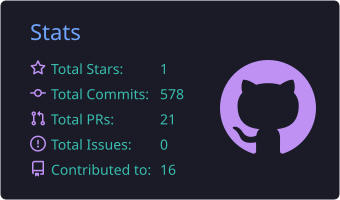
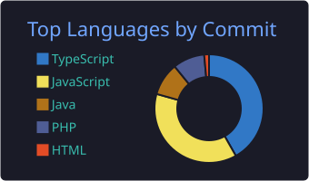

<!-- Banner -->

 

---

## 👋 About me

Full-stack developer who ships web applications end to end — Spring Boot APIs, React / Next.js interfaces, and the business logic that ties them together. I care about clean architecture, solid performance, and minimalist UI that feels effortless to use.

- 💼 Full-stack Intern at **AI POWER INTERN** — building SCIDERM (an Odoo-based ERP for a spa) and the Việt Mỹ system with Spring Boot + ReactJS
- 🔭 Shipping real products, not just tutorials — from AI-assisted e-commerce to music streaming
- 🧠 Going deeper into backend design, cloud integration, and application security

---

## 💼 Experience

**Full-stack Intern @ AI POWER INTERN** · *Aug 2026 – Present*

| Project | What I work on |
| :-- | :-- |
| 🧖 **SCIDERM** | ERP-style internal management system for a spa, built on **Odoo** |
| 🌎 **Việt Mỹ** | Web application built with **Spring Boot** and **ReactJS** |

> 💡 Learned to understand business requirements, ask the right questions to clarify them, and use AI in my daily workflow — e.g. building a plan to analyze what's missing every time the leader sends a new requirement.

---

## 🚀 Featured Projects

| Project | Description | Tech |
| :-- | :-- | :-- |
| 👗 **[COUTURE](https://fashion-opal-nu.vercel.app/)** [FE](https://github.com/thaithanhquan-swe/fashion) · [BE](https://github.com/thaithanhquan-swe/fashion_be) | Premium fashion e-commerce platform with an AI shopping assistant for automated customer support and dynamic VietQR bank-transfer payments | `Spring Boot` `TypeScript` `JWT` `Cloudinary` `Firebase OAuth2` `Groq` |
| 🎵 **[Echora](https://echora-jet.vercel.app/)** | Spotify-style clone that goes beyond music — also lets you watch movies and videos from YouTube in one place | `YouTube` |
| 🎧 **[Audiomesh](https://audiomesh.vercel.app/)** | SoundCloud-inspired streaming platform — upload tracks, share with the community, glassmorphic UI | `Next.js` `TypeScript` `Tailwind` |
| 🎬 **[PhimHub](https://phimhub-kappa.vercel.app/)** | Netflix-style movie website with a clean, cinematic browsing experience | `React` |
| 🎟️ **EventHub (Beetic)** | Event management & ticketing with QR payment, PDF tickets, and an AI chatbot | `ReactJS` `Spring Boot` |
| 🤖 **P-Advisor (AskBot PTIT)** | Closed-domain RAG chatbot for PTIT admissions — 3-person team where I'm the team leader and own the backend | `Spring Boot` `React` `Vite` `Tailwind` |

---

## 🛠️ Tech Stack

*Familiar with Vulnerability Assessment, Network Monitoring (Wazuh, Suricata), and pfSense firewall configs.*

---

## 📊 GitHub Stats

---

